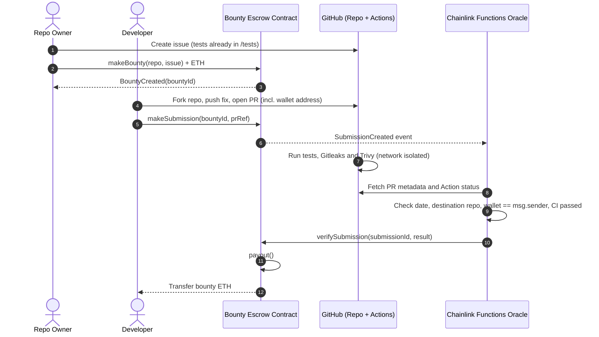
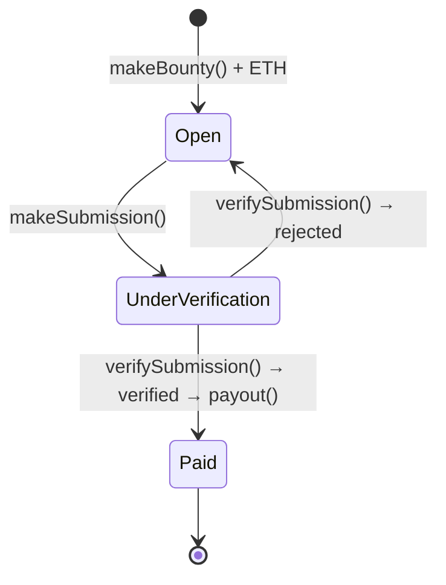

# CI-Gated Trustless Open-Source Bounty Payout System

> An automated, trustless escrow that pays open-source contributors in ETH the moment their pull request passes a hardened CI/CD security pipeline — no manual approval, no centralized intermediary.


> **Project status:** This repository is currently a **case study / design specification**. It holds the architecture, the threat model and the planned interfaces. The smart contracts, CI workflows, oracle scripts and frontend are not implemented yet (see [Roadmap](#roadmap)).

---

## Table of Contents

- [Overview](#overview)
- [Problem Statement](#problem-statement)
  - [Human Overhead & Delayed Settlement](#a-human-overhead--delayed-settlement)
  - [Security & Verification Vulnerabilities](#b-security--verification-vulnerabilities)
- [Key Goals & Success Criteria](#key-goals--success-criteria)
- [System Architecture](#system-architecture)
  - [Architecture Diagram](#architecture-diagram)
  - [Actors](#actors)
  - [Components](#components)
  - [End-to-End Workflow](#end-to-end-workflow)
  - [Sequence Diagram](#sequence-diagram)
- [Smart Contract Design](#smart-contract-design)
  - [Core Functions](#core-functions)
  - [Bounty & Submission Lifecycle](#bounty--submission-lifecycle)
  - [Proposed Interface](#proposed-interface)
  - [On-Chain Security Considerations](#on-chain-security-considerations)
- [CI/CD Security Gating](#cicd-security-gating)
  - [Gitleaks: Secret Detection](#gitleaks-secret-detection)
  - [Trivy: Vulnerability Scan](#trivy-vulnerability-scan)
  - [Folder-Level Permissioning for /tests](#folder-level-permissioning-for-tests)
  - [Network & API Isolation](#network--api-isolation)
  - [Example Workflow (Sketch)](#example-workflow-sketch)
- [Oracle Verification (Chainlink Functions)](#oracle-verification-chainlink-functions)
- [Threat Model Summary](#threat-model-summary)

---

## Overview

Traditional open-source bounty platforms and freelance development workflows depend on:

- **manual human verification** of submitted work,
- **subjective review processes** that can take weeks, and
- **centralized escrow intermediaries** that hold funds and decide on releases.

This adds administrative overhead, delays payment, creates security risks and causes trust friction between repository owners and external contributors.

This project proposes a **programmatic, trustless bounty escrow** that links **Ethereum smart contracts** to an **automated CI/CD security pipeline**:

1. A repository owner **locks ETH** for a GitHub issue in a smart contract.
2. A developer opens a **pull request** from their fork and includes their **wallet address** in it.
3. **GitHub Actions** runs the project's test suite plus secret-leak and vulnerability scans in an **isolated, network-restricted** environment. The `/tests` folder is protected so contributors can't change it.
4. A **Chainlink oracle / relayer** checks the PR metadata and the CI result. Then it reports back on-chain.
5. The contract **releases the bounty straight to the developer's wallet** within seconds of verification.

---

## Problem Statement

### A. Human Overhead & Delayed Settlement

| Problem | Impact |
|---|---|
| **Subjective & slow code reviews** | Maintainers are overloaded, so review queues stretch to several weeks before a bounty payout is approved and processed. |
| **Payment trust friction** | Developers risk late payment or none at all after delivering work. Repository owners risk paying for incomplete or low-quality code. |

### B. Security & Verification Vulnerabilities

Running and paying out automatically for PRs from **untrusted forks** opens several attack vectors:

| Threat | Description |
|---|---|
| **Secret & credential leakage** | Unvetted code in a PR may leak secrets, API keys or credentials into public repositories, by accident or on purpose. |
| **Malicious code injection** | Forked contributions may carry vulnerabilities, malicious dependencies or harmful payloads aimed at the project. |
| **Test suite tampering** | A contributor may alter, bypass or delete existing unit/integration tests so the build passes artificially. |
| **CI environment exploitation** | Unrestricted GitHub Actions workflows can be abused by malicious PR scripts to make outgoing network calls or exfiltrate environment secrets. |

---

## Key Goals & Success Criteria

| Goal | Success criterion |
|---|---|
| **100% automated execution** | Standard bounty payouts need no human approval once the tests and security checks pass (**exit code `0`**). |
| **Zero-trust code assurance** | Secret leaks, malicious code merges and test-tampering attempts are fully blocked *before* anything runs on-chain. |
| **Instant compensation** | Payout time drops from **weeks to seconds** after verification. |

---

## System Architecture

The system links four building blocks into one automated pipeline: a **Next.js 14 frontend**, **Solidity smart contracts**, a **GitHub Actions CI/CD verification engine** and a **Chainlink oracle / relayer bridge**.

### Architecture Diagram


The same flow, simplified:

```text
[Repo Owner] ---> Deposit Funds & Create Issue ---> [Smart Contract: makeBounty()]
                                                              |
[Developer]  ---> Submit PR with Wallet Address --------------+
                                                              |
                                                              v
                                          [GitHub Actions CI/CD Pipeline]
                                           ├─ Runs Test Suite (Folder Perms Protected)
                                           ├─ Gitleaks Scan (Secret Detection)
                                           └─ Trivy Scan (Vulnerability Scan)
                                                              |
                                                       (Exit Code 0)
                                                              |
                                                              v
 [Smart Contract: payout()] <--- Verified Event <--- [Chainlink Oracle / Relayer]
```

### Actors

| Actor | Owns | Responsibilities |
|---|---|---|
| **Repository Owner** | The original ("OG") repository | Opens a GitHub issue describing the task. Makes sure the repo **already has tests for the new issue** and a GitHub Actions workflow. Funds the bounty by calling `makeBounty()`. |
| **Developer** | A forked repository with their code | Implements the fix in the fork. Opens a PR against the original repo **with their wallet address in it**. Registers the work on-chain by calling `makeSubmission()`. |
| **Chainlink Oracle (Functions)** | Off-chain compute / relayer | Listens for submission events. Checks PR metadata and the GitHub Actions status. Reports the result back to the contract (`verifySubmission()`). |
| **Smart Contract** | Escrowed ETH | Holds the bounty funds, records submissions and releases funds through `payout()` once verification succeeds. |

### Components

| Component | Technology | Role |
|---|---|---|
| **Frontend dApp** | Next.js 14 + wallet connection (e.g. wagmi / ethers.js) | Lets owners create and fund bounties, lets developers submit PRs and wallet addresses, and shows bounty and payout status. |
| **Escrow contract** | Solidity on an EVM chain | Holds ETH per bounty and runs `makeBounty()`, `makeSubmission()`, `verifySubmission()` and `payout()`. |
| **Verification engine** | GitHub Actions | Runs the protected test suite, a **Gitleaks** secret scan and a **Trivy** vulnerability scan in an isolated runner with outbound network traffic blocked. |
| **Oracle / relayer bridge** | Chainlink Functions | Reads PR and CI data from the GitHub API, checks it against the on-chain submission and calls back into the contract. |

### End-to-End Workflow

1. **Issue creation:** The repo owner opens a GitHub issue that describes the task. The test cases that define "done" for this issue are already committed in the protected `/tests` directory.
2. **Bounty funding:** The owner calls `makeBounty()` with ETH attached. The funds are locked in escrow and tied to the repo and issue.
3. **Development:** The developer forks the repo and implements the change.
4. **Pull request:** The developer opens a PR against the original repo and **puts their wallet address in the PR**.
5. **On-chain submission:** The developer calls `makeSubmission()` with the bounty ID and the PR reference. The contract records the submission and **emits an event**.
6. **CI verification:** The PR triggers the GitHub Actions workflow on the **source repository**. It runs these checks:
   - every test case (with `/tests` protected against changes),
   - a **Gitleaks** scan for leaked credentials,
   - a **Trivy** scan for vulnerabilities and malicious packages,
   - all inside a runner with **outgoing network traffic blocked** and **no real API keys**.
7. **Oracle check:** The event triggers the Chainlink Functions oracle. It checks four things:
   - the **PR date** (submitted inside the bounty window),
   - the **PR destination repo** (it targets the funded repository),
   - the **wallet address in the PR** matches the `msg.sender` of `makeSubmission()`,
   - the **GitHub Action status** (every job passed with exit code `0`).
8. **Verification:** If every check passes, the oracle calls `verifySubmission()` on the contract.
9. **Payout:** `verifySubmission()` calls `payout()`, which sends the escrowed ETH **straight to the developer's wallet**.

### Sequence Diagram



---

## Smart Contract Design

The escrow contract is the **single source of truth** for bounty funds. It never trusts the developer's claims on their own: funds move only after the authorised oracle confirms them.

### Core Functions

| Function | Caller | Description |
|---|---|---|
| `makeBounty()` | Repo owner | Creates a bounty for a GitHub repo + issue and **locks the ETH sent** (`msg.value`) in escrow. Emits `BountyCreated`. |
| `makeSubmission()` | Developer | Registers a PR against an open bounty. The caller's address (`msg.sender`) is recorded as the payout address the oracle checks against. Emits `SubmissionCreated`, which triggers the oracle. |
| `verifySubmission()` | Chainlink oracle only | Receives the oracle's verdict. If the submission is valid, marks it verified and calls `payout()`; otherwise marks it rejected. |
| `payout()` | Internal (from `verifySubmission()`) | Transfers the escrowed ETH to the verified developer's wallet and closes the bounty. Emits `BountyPaid`. |

### Bounty & Submission Lifecycle



| State | Meaning |
|---|---|
| **Open** | Funded and accepting submissions. |
| **UnderVerification** | A submission has been registered and the oracle is checking it. |
| **Paid** | A submission was verified and the ETH went to the developer. This state is final. |

### Proposed Interface

> Illustrative only. The final signatures may change during implementation.

```solidity
// SPDX-License-Identifier: MIT
pragma solidity ^0.8.20;

interface IBountyEscrow {
    enum BountyStatus { Open, UnderVerification, Paid }

    struct Bounty {
        address owner;          // repo owner who funded the bounty
        string  repo;           // e.g. "org/project"
        uint256 issueNumber;    // GitHub issue the bounty is attached to
        uint256 amount;         // escrowed wei
        BountyStatus status;
    }

    struct Submission {
        uint256 bountyId;
        address developer;      // msg.sender of makeSubmission(), the payout address
        uint256 prNumber;       // pull request against `repo`
        uint256 submittedAt;
        bool    verified;
    }

    event BountyCreated(uint256 indexed bountyId, address indexed owner, string repo, uint256 issueNumber, uint256 amount);
    event SubmissionCreated(uint256 indexed submissionId, uint256 indexed bountyId, address indexed developer, uint256 prNumber);
    event SubmissionVerified(uint256 indexed submissionId, bool success);
    event BountyPaid(uint256 indexed bountyId, address indexed developer, uint256 amount);

    /// Repo owner locks ETH for a GitHub issue.
    function makeBounty(string calldata repo, uint256 issueNumber) external payable returns (uint256 bountyId);

    /// Developer registers a PR; triggers the off-chain oracle request.
    function makeSubmission(uint256 bountyId, uint256 prNumber) external returns (uint256 submissionId);

    /// Oracle callback carrying the verification result. Restricted to the oracle.
    function verifySubmission(uint256 submissionId, bool success) external;
}
```

### On-Chain Security Considerations

| Concern | Mitigation |
|---|---|
| **Unauthorised verification** | `verifySubmission()` accepts calls **only from the configured Chainlink oracle / router address** (an `onlyOracle` check). |
| **Re-entrancy on payout** | Follow checks-effects-interactions: set the state to `Paid` **before** transferring ETH. Add a `nonReentrant` guard. |
| **Double payout** | A bounty in the `Paid` state can't be verified or paid again. |
| **Wallet spoofing** | The oracle checks that the wallet address written in the PR equals the `msg.sender` that called `makeSubmission()`. Nobody can claim someone else's PR. |
| **Stale or replayed submissions** | The oracle checks the PR date against when the bounty was created and when the submission was made. |
| **Failed ETH transfers** | Use `call{value: ...}` and check the return value, or a pull-payment withdrawal pattern as a fallback. |

---

## CI/CD Security Gating

When a PR is submitted, an **isolated GitHub Actions verification workflow** runs on the **source (original) repository**. A payout can happen only if **every** job succeeds (exit code `0`).

```text
PR opened ──► GitHub Actions (isolated runner, no outbound network, no real secrets)
               ├─ 1. Protected test suite   (/tests cannot be modified by the PR)
               ├─ 2. Gitleaks               (secret & credential detection)
               └─ 3. Trivy                  (vulnerabilities & malicious packages)
                         │
                   all exit 0? ──► status = success ──► read by the oracle
```

### Gitleaks: Secret Detection

- Scans the PR diff and commit history for **API keys, tokens, private keys and credentials**.
- **Threat addressed:** unvetted code leaking secrets to an attacker, by accident or on purpose.
- Any finding fails the job, so no payout happens.

### Trivy: Vulnerability Scan

- Scans the filesystem and dependency manifests for **known CVEs, misconfigurations and malicious packages**.
- **Threat addressed:** forked contributions bringing in malicious code or vulnerable dependencies.
- Findings at or above the configured severity (e.g. `HIGH,CRITICAL`) fail the job.

### Folder-Level Permissioning for `/tests`

- The repo owner commits the tests for the issue **before** the bounty is opened. They define what "done" means.
- The workflow fails if the PR **adds, modifies or deletes anything under `/tests`**. It can also force-check out `/tests` from the base branch before running.
- `CODEOWNERS` plus branch protection on `/tests` add a second layer of protection.
- **Threat addressed:** contributors removing or weakening tests to force a passing build.

### Network & API Isolation

- Outbound network traffic is **blocked** while untrusted code runs (for example with an egress-blocking step or a container started with `--network none`).
- The verification workflow uses **no production API keys or secrets**. It uses the `pull_request` trigger, which doesn't expose repository secrets to fork PRs, plus a minimal `permissions:` block.
- **Threat addressed:** malicious PR scripts making outgoing calls or exfiltrating environment secrets.

### Example Workflow (Sketch)

> Illustrative only. Action versions and configuration will be pinned during implementation.

```yaml
name: bounty-verification

on:
  pull_request:            # fork PRs run without repository secrets

permissions:
  contents: read           # least privilege

jobs:
  protect-tests:
    runs-on: ubuntu-latest
    steps:
      - uses: actions/checkout@v4
        with: { fetch-depth: 0 }
      - name: Fail if /tests was modified
        run: |
          if git diff --name-only origin/${{ github.base_ref }}...HEAD | grep -q '^tests/'; then
            echo "::error::Changes to /tests are not allowed"; exit 1
          fi

  gitleaks:
    runs-on: ubuntu-latest
    steps:
      - uses: actions/checkout@v4
        with: { fetch-depth: 0 }
      - uses: gitleaks/gitleaks-action@v2

  trivy:
    runs-on: ubuntu-latest
    steps:
      - uses: actions/checkout@v4
      - uses: aquasecurity/trivy-action@master
        with:
          scan-type: fs
          severity: HIGH,CRITICAL
          exit-code: '1'

  tests:
    needs: [protect-tests, gitleaks, trivy]
    runs-on: ubuntu-latest
    steps:
      - uses: actions/checkout@v4
      - name: Run test suite with networking disabled
        run: docker run --rm --network none -v "$PWD:/app" -w /app <test-image> <test-command>
```

---

## Oracle Verification (Chainlink Functions)

The `SubmissionCreated` event triggers a **Chainlink Functions** request. The off-chain JavaScript source queries the GitHub API and returns one verdict to the contract.

| Check | What is verified | Why |
|---|---|---|
| **PR date** | The PR was created and updated after the bounty was opened and before the submission / deadline. | Stops reuse of old or unrelated PRs. |
| **PR destination repo** | The PR's base repository matches the `repo` stored on the bounty. | Stops pointing the bounty at a PR in a repo the attacker controls. |
| **PR wallet address == `msg.sender`** | The wallet address in the PR body matches the address that called `makeSubmission()`. | Ties the PR author to the payout address and blocks front-running or claiming someone else's PR. |
| **GitHub Action status** | Every required check run for the PR's head commit finished with `success`. | Makes sure tests, Gitleaks and Trivy all passed (exit code `0`). |

If **all** checks pass, the oracle calls `verifySubmission(submissionId, true)` and the contract immediately runs `payout()`. Otherwise the submission is rejected and the bounty stays open.

---

## Threat Model Summary

| # | Threat | Attack vector | Safeguard | Layer |
|---|---|---|---|---|
| 1 | Secret / credential leakage | PR commits hard-coded keys or tokens | Gitleaks scan; no real secrets in CI | CI |
| 2 | Malicious code injection | Malicious dependency or payload in the fork | Trivy scan; blocked network | CI |
| 3 | Test suite tampering | PR deletes or weakens tests to force a pass | `/tests` folder protection + CODEOWNERS | CI / GitHub |
| 4 | CI environment exploitation | PR script calls out or exfiltrates env vars | Network isolation, `pull_request` trigger, least-privilege `permissions` | CI |
| 5 | Payout to the wrong person | Attacker claims someone else's PR | Oracle checks the PR wallet against `msg.sender` | Oracle |
| 6 | Fake verification | Attacker calls `verifySubmission()` directly | `onlyOracle` access control | Contract |
| 7 | Double spend / re-entrancy | Re-entering `payout()` | State update before transfer + `nonReentrant` | Contract |
| 8 | Owner non-payment | Owner withdraws after work is delivered | Funds locked in escrow when the bounty is created | Contract |
