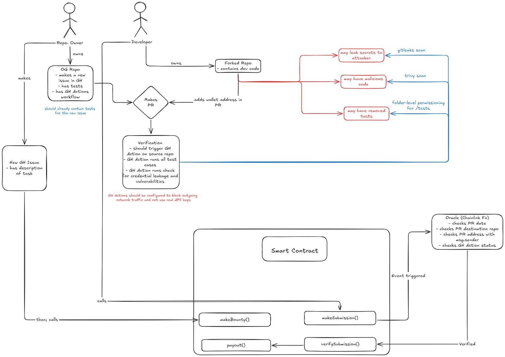
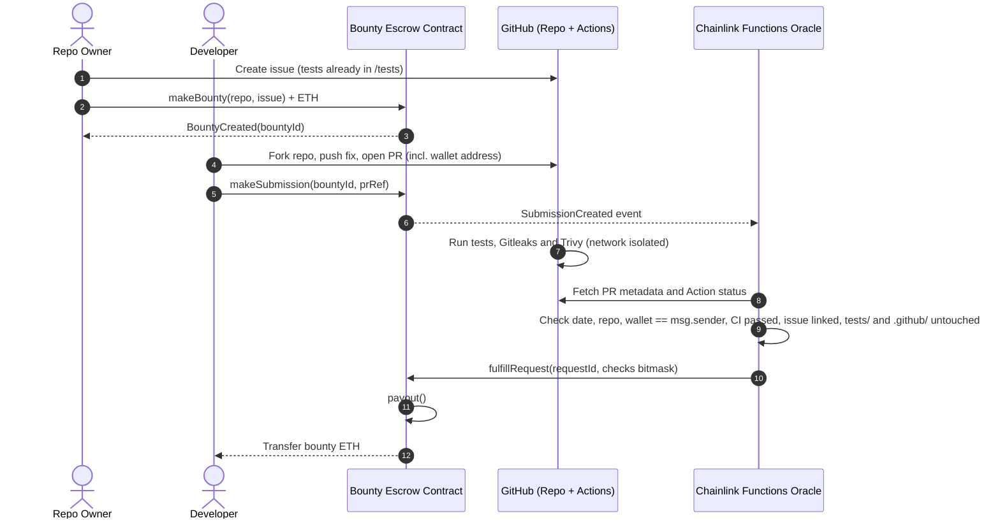
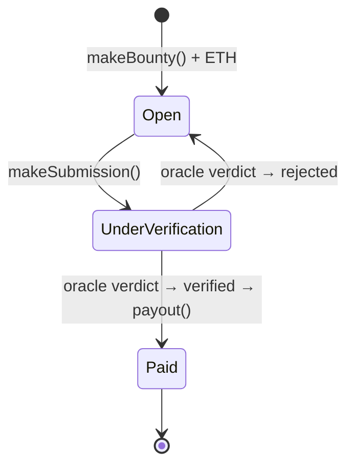

# CI-Gated Trustless Open-Source Bounty Payout System
# Case study for Blockchain- 23CSE335
# By:- Adiseshan and Akshay
> An automated, trustless escrow that pays open-source contributors in ETH the moment their pull request passes a hardened CI/CD security pipeline — no manual approval, no centralized intermediary.


> **Project status:** The **escrow smart contract**, the **Chainlink Functions oracle source**, the **relayer** and the **Next.js frontend** are implemented and tested locally. The frontend reads the deployed contract and shows all six oracle checks from the `SubmissionChecks` event/`submissionChecks` mapping (with a mock fallback for offline development). The GitHub Actions verification workflow and the Sepolia deployment are still to do (see [Roadmap](#roadmap)).

---

## Table of Contents

- [Overview](#overview)
- [Problem Statement](#problem-statement)
  - [Human Overhead & Delayed Settlement](#a-human-overhead--delayed-settlement)
  - [Security & Verification Vulnerabilities](#b-security--verification-vulnerabilities)
- [Key Goals & Success Criteria](#key-goals--success-criteria)
- [System Architecture](#system-architecture)
  - [Architecture Diagram](#architecture-diagram)
  - [Actors](#actors)
  - [Components](#components)
  - [End-to-End Workflow](#end-to-end-workflow)
  - [Sequence Diagram](#sequence-diagram)
- [Smart Contract Design](#smart-contract-design)
  - [Core Functions](#core-functions)
  - [Bounty & Submission Lifecycle](#bounty--submission-lifecycle)
  - [Contract Interface](#contract-interface)
  - [On-Chain Security Considerations](#on-chain-security-considerations)
- [CI/CD Security Gating](#cicd-security-gating)
  - [Gitleaks: Secret Detection](#gitleaks-secret-detection)
  - [Trivy: Vulnerability Scan](#trivy-vulnerability-scan)
  - [Folder-Level Permissioning for /tests](#folder-level-permissioning-for-tests)
  - [Network & API Isolation](#network--api-isolation)
  - [Example Workflow (Sketch)](#example-workflow-sketch)
- [Oracle Verification (Chainlink Functions)](#oracle-verification-chainlink-functions)
  - [Verification Checks](#verification-checks)
  - [Two Verification Paths](#two-verification-paths)
- [Threat Model Summary](#threat-model-summary)
- [Tech Stack](#tech-stack)
- [Repository Structure](#repository-structure)
- [Getting Started](#getting-started)
  - [Smart Contracts](#smart-contracts)
  - [Oracle](#oracle)
  - [Local End-to-End Run (Relayer Path)](#local-end-to-end-run-relayer-path)
  - [Sepolia Deployment (Chainlink Functions Path)](#sepolia-deployment-chainlink-functions-path)
  - [Frontend](#frontend)
  - [Submitting a PR for a Bounty](#submitting-a-pr-for-a-bounty)
- [Trust Assumptions & Known Limitations](#trust-assumptions--known-limitations)
- [Roadmap](#roadmap)
- [Contributing](#contributing)
- [License](#license)
- [Author](#author)

---

## Overview

Traditional open-source bounty platforms and freelance development workflows depend on:

- **manual human verification** of submitted work,
- **subjective review processes** that can take weeks, and
- **centralized escrow intermediaries** that hold funds and decide on releases.

This adds administrative overhead, delays payment, creates security risks and causes trust friction between repository owners and external contributors.

This project proposes a **programmatic, trustless bounty escrow** that links **Ethereum smart contracts** to an **automated CI/CD security pipeline**:

1. A repository owner **locks ETH** for a GitHub issue in a smart contract.
2. A developer opens a **pull request** from their fork and includes their **wallet address** in it.
3. **GitHub Actions** runs the project's test suite plus secret-leak and vulnerability scans in an **isolated, network-restricted** environment. The `/tests` folder is protected so contributors can't change it.
4. A **Chainlink oracle / relayer** checks the PR metadata and the CI result. Then it reports back on-chain.
5. The contract **releases the bounty straight to the developer's wallet** within seconds of verification.

---

## Problem Statement

### A. Human Overhead & Delayed Settlement

| Problem | Impact |
|---|---|
| **Subjective & slow code reviews** | Maintainers are overloaded, so review queues stretch to several weeks before a bounty payout is approved and processed. |
| **Payment trust friction** | Developers risk late payment or none at all after delivering work. Repository owners risk paying for incomplete or low-quality code. |

### B. Security & Verification Vulnerabilities

Running and paying out automatically for PRs from **untrusted forks** opens several attack vectors:

| Threat | Description |
|---|---|
| **Secret & credential leakage** | Unvetted code in a PR may leak secrets, API keys or credentials into public repositories, by accident or on purpose. |
| **Malicious code injection** | Forked contributions may carry vulnerabilities, malicious dependencies or harmful payloads aimed at the project. |
| **Test suite tampering** | A contributor may alter, bypass or delete existing unit/integration tests so the build passes artificially. |
| **CI environment exploitation** | Unrestricted GitHub Actions workflows can be abused by malicious PR scripts to make outgoing network calls or exfiltrate environment secrets. |

---

## Key Goals & Success Criteria

| Goal | Success criterion |
|---|---|
| **100% automated execution** | Standard bounty payouts need no human approval once the tests and security checks pass (**exit code `0`**). |
| **Zero-trust code assurance** | Secret leaks, malicious code merges and test-tampering attempts are fully blocked *before* anything runs on-chain. |
| **Instant compensation** | Payout time drops from **weeks to seconds** after verification. |

---

## System Architecture

The system links four building blocks into one automated pipeline: a **Next.js 14 frontend**, **Solidity smart contracts**, a **GitHub Actions CI/CD verification engine** and a **Chainlink oracle / relayer bridge**.

### Architecture Diagram



The same flow, simplified:

```text
[Repo Owner] ---> Deposit Funds & Create Issue ---> [Smart Contract: makeBounty()]
                                                              |
[Developer]  ---> Submit PR with Wallet Address --------------+
                                                              |
                                                              v
                                          [GitHub Actions CI/CD Pipeline]
                                           ├─ Runs Test Suite (Folder Perms Protected)
                                           ├─ Gitleaks Scan (Secret Detection)
                                           └─ Trivy Scan (Vulnerability Scan)
                                                              |
                                                       (Exit Code 0)
                                                              |
                                                              v
 [Smart Contract: payout()] <--- Verified Event <--- [Chainlink Oracle / Relayer]
```

### Actors

| Actor | Owns | Responsibilities |
|---|---|---|
| **Repository Owner** | The original ("OG") repository | Opens a GitHub issue describing the task. Makes sure the repo **already has tests for the new issue** and a GitHub Actions workflow. Funds the bounty by calling `makeBounty()`. |
| **Developer** | A forked repository with their code | Implements the fix in the fork. Opens a PR against the original repo **with their wallet address in it**. Registers the work on-chain by calling `makeSubmission()`. |
| **Chainlink Oracle (Functions)** | Off-chain compute / relayer | Listens for submission events. Checks PR metadata and the GitHub Actions status. Reports the result back to the contract through the Functions callback, or through `verifySubmission()` when the relayer path is used. |
| **Smart Contract** | Escrowed ETH | Holds the bounty funds, records submissions and releases funds through `payout()` once verification succeeds. |

### Components

| Component | Technology | Role |
|---|---|---|
| **Frontend dApp** | Next.js 14 + wallet connection (e.g. wagmi / ethers.js) | Lets owners create and fund bounties, lets developers submit PRs and wallet addresses, and shows bounty and payout status. |
| **Escrow contract** | Solidity on an EVM chain | Holds ETH per bounty and runs `makeBounty()`, `makeSubmission()`, the oracle callback / `verifySubmission()` and `payout()`. |
| **Verification engine** | GitHub Actions | Runs the protected test suite, a **Gitleaks** secret scan and a **Trivy** vulnerability scan in an isolated runner with outbound network traffic blocked. |
| **Oracle / relayer bridge** | Chainlink Functions | Reads PR and CI data from the GitHub API, checks it against the on-chain submission and calls back into the contract. |

### End-to-End Workflow

1. **Issue creation:** The repo owner opens a GitHub issue that describes the task. The test cases that define "done" for this issue are already committed in the protected `/tests` directory.
2. **Bounty funding:** The owner calls `makeBounty()` with ETH attached. The funds are locked in escrow and tied to the repo and issue.
3. **Development:** The developer forks the repo and implements the change.
4. **Pull request:** The developer opens a PR against the original repo and **puts their wallet address in the PR**.
5. **On-chain submission:** The developer calls `makeSubmission()` with the bounty ID and the PR reference. The contract records the submission and **emits an event**.
6. **CI verification:** The PR triggers the GitHub Actions workflow on the **source repository**. It runs these checks:
   - every test case (with `/tests` protected against changes),
   - a **Gitleaks** scan for leaked credentials,
   - a **Trivy** scan for vulnerabilities and malicious packages,
   - all inside a runner with **outgoing network traffic blocked** and **no real API keys**.
7. **Oracle check:** `makeSubmission()` sends a Chainlink Functions request. The DON checks six things (see [Verification Checks](#verification-checks)):
   - the **PR date** (submitted inside the bounty window),
   - the **PR destination repo** (it targets the funded repository),
   - the **wallet address in the PR** matches the `msg.sender` of `makeSubmission()`,
   - the **GitHub Action status** (every job passed with exit code `0`),
   - the PR **closes the bounty's issue**,
   - the PR **doesn't touch `tests/` or `.github/`**.
8. **Verification:** The DON returns the result to the contract through the Functions router. With the relayer path, the relayer calls `verifySubmission()` instead.
9. **Payout:** If every check passed, the contract calls `payout()`, which sends the escrowed ETH **straight to the developer's wallet**.

### Sequence Diagram



---

## Smart Contract Design

The escrow contract is the **single source of truth** for bounty funds. It never trusts the developer's claims on their own: funds move only after the authorised oracle confirms them.

### Core Functions

| Function | Caller | Description |
|---|---|---|
| `makeBounty()` | Repo owner | Creates a bounty for a GitHub repo + issue and **locks the ETH sent** (`msg.value`) in escrow. Emits `BountyCreated`. |
| `makeSubmission()` | Developer | Registers a PR against an open bounty. The caller's address (`msg.sender`) is recorded as the payout address the oracle checks against. Emits `SubmissionCreated`, which triggers the oracle. |
| `fulfillRequest()` | Chainlink Functions router only | Receives the DON's bitmask of passed checks. If all six bits are set, the submission is verified and `payout()` runs; otherwise it is rejected. |
| `verifySubmission()` | Relayer only | Same verdict, delivered by the off-chain relayer (`oracle/relayer.js`) instead of the DON. |
| `payout()` | Internal (after a successful verification) | Transfers the escrowed ETH to the verified developer's wallet and closes the bounty. Emits `BountyPaid`. |
| `withdraw()` | Developer | Claims a payout whose direct transfer failed, e.g. a contract wallet that rejected ETH. |
| `setFunctionsConfig()`, `setSecrets()`, `setRelayer()` | Contract owner | Configure the Chainlink subscription, DON ID, oracle source, DON-hosted secrets and the relayer address. |

### Bounty & Submission Lifecycle



| State | Meaning |
|---|---|
| **Open** | Funded and accepting submissions. |
| **UnderVerification** | At least one submission is registered and the oracle is checking it. A rejected submission moves the bounty back to **Open** once no other submissions are pending. |
| **Paid** | A submission was verified and the ETH went to the developer. This state is final. |

### Contract Interface

The public interface is [`contracts/contracts/interfaces/IBountyEscrow.sol`](contracts/contracts/interfaces/IBountyEscrow.sol) and the implementation is [`contracts/contracts/BountyEscrow.sol`](contracts/contracts/BountyEscrow.sol). The frontend's ABI ([`frontend/src/lib/contracts/abi.ts`](frontend/src/lib/contracts/abi.ts)) is generated from [`contracts/abi/BountyEscrow.json`](contracts/abi/BountyEscrow.json) with `npm run sync-abi`, so it matches this interface exactly — changing a struct or event is a breaking change.

```solidity
interface IBountyEscrow {
    enum BountyStatus { Open, UnderVerification, Paid }

    struct Bounty     { address owner; string repo; uint256 issueNumber; uint256 amount; BountyStatus status; }
    struct Submission { uint256 bountyId; address developer; uint256 prNumber; uint256 submittedAt; bool verified; }

    event BountyCreated(uint256 indexed bountyId, address indexed owner, string repo, uint256 issueNumber, uint256 amount);
    event SubmissionCreated(uint256 indexed submissionId, uint256 indexed bountyId, address indexed developer, uint256 prNumber);
    event SubmissionVerified(uint256 indexed submissionId, bool success);
    event BountyPaid(uint256 indexed bountyId, address indexed developer, uint256 amount);

    function makeBounty(string calldata repo, uint256 issueNumber) external payable returns (uint256 bountyId);
    function makeSubmission(uint256 bountyId, uint256 prNumber) external returns (uint256 submissionId);
    function verifySubmission(uint256 submissionId, bool success) external;   // relayer only

    function getBounty(uint256 bountyId) external view returns (Bounty memory);
    function getSubmission(uint256 submissionId) external view returns (Submission memory);
    function bountyCount() external view returns (uint256);
}
```

`BountyEscrow` adds these on top:

| Addition | Purpose |
|---|---|
| `SubmissionChecks(submissionId, checks)` event + `submissionChecks(id)` | The 6-bit mask of which oracle checks passed, so the UI can show each check. |
| `VerificationRequested(submissionId, requestId)` event | Links a submission to its Chainlink Functions request. |
| `OracleError(submissionId, err)` event | The DON returned an error, for example GitHub was unreachable or the PR doesn't exist. |
| `PayoutDeferred` / `Withdrawn` events, `pendingWithdrawals(addr)` | Pull-payment fallback when a direct payout fails. |
| `bountyCreatedAt`, `pendingSubmissions`, `isResolved`, `submissionCount` | Read helpers for the oracle, relayer and frontend. |

### On-Chain Security Considerations

| Concern | Mitigation |
|---|---|
| **Unauthorised verification** | Chainlink results are only accepted from the Functions router (`OnlyRouterCanFulfill`) and only for request IDs the contract issued. `verifySubmission()` is `onlyRelayer`, and setting the relayer to the zero address disables it. |
| **Re-entrancy on payout** | Checks-effects-interactions: the bounty is set to `Paid` **before** ETH is sent, settlement and `withdraw()` share a `nonReentrant` lock, and the payout forwards only 50,000 gas. |
| **Double payout** | A `Paid` bounty rejects new submissions, and any other pending submission that passes later resolves as `success = false`. Each submission can be resolved only once. |
| **Stuck Chainlink callbacks** | `fulfillRequest` never reverts: unknown or already-resolved requests are ignored, and errors or malformed responses count as rejections. |
| **Duplicate / spam submissions** | The same PR can't be pending twice on one bounty. |
| **URL injection into the oracle** | `makeBounty` accepts only `owner/name` repo strings made of `[A-Za-z0-9._-]`, so the oracle can safely build GitHub API URLs from them. |
| **Wallet spoofing** | The oracle checks that the wallet address written in the PR equals the `msg.sender` that called `makeSubmission()`. Nobody can claim someone else's PR. |
| **Stale or replayed submissions** | The oracle checks the PR date against when the bounty was created and when the submission was made. |
| **Failed ETH transfers** | `call{value: ...}` with a checked result. If it fails, the amount is credited to `pendingWithdrawals` and the developer claims it with `withdraw()`. |

---

## CI/CD Security Gating

When a PR is submitted, an **isolated GitHub Actions verification workflow** runs on the **source (original) repository**. A payout can happen only if **every** job succeeds (exit code `0`).

```text
PR opened ──► GitHub Actions (isolated runner, no outbound network, no real secrets)
               ├─ 1. Protected test suite   (/tests cannot be modified by the PR)
               ├─ 2. Gitleaks               (secret & credential detection)
               └─ 3. Trivy                  (vulnerabilities & malicious packages)
                         │
                   all exit 0? ──► status = success ──► read by the oracle
```

### Gitleaks: Secret Detection

- Scans the PR diff and commit history for **API keys, tokens, private keys and credentials**.
- **Threat addressed:** unvetted code leaking secrets to an attacker, by accident or on purpose.
- Any finding fails the job, so no payout happens.

### Trivy: Vulnerability Scan

- Scans the filesystem and dependency manifests for **known CVEs, misconfigurations and malicious packages**.
- **Threat addressed:** forked contributions bringing in malicious code or vulnerable dependencies.
- Findings at or above the configured severity (e.g. `HIGH,CRITICAL`) fail the job.

### Folder-Level Permissioning for `/tests`

- The repo owner commits the tests for the issue **before** the bounty is opened. They define what "done" means.
- The workflow fails if the PR **adds, modifies or deletes anything under `/tests`**. It can also force-check out `/tests` from the base branch before running.
- `CODEOWNERS` plus branch protection on `/tests` add a second layer of protection.
- **Threat addressed:** contributors removing or weakening tests to force a passing build.

### Network & API Isolation

- Outbound network traffic is **blocked** while untrusted code runs (for example with an egress-blocking step or a container started with `--network none`).
- The verification workflow uses **no production API keys or secrets**. It uses the `pull_request` trigger, which doesn't expose repository secrets to fork PRs, plus a minimal `permissions:` block.
- **Threat addressed:** malicious PR scripts making outgoing calls or exfiltrating environment secrets.

### Example Workflow (Sketch)

> Illustrative only. Action versions and configuration will be pinned during implementation.

```yaml
name: bounty-verification

on:
  pull_request:            # fork PRs run without repository secrets

permissions:
  contents: read           # least privilege

jobs:
  protect-tests:
    runs-on: ubuntu-latest
    steps:
      - uses: actions/checkout@v4
        with: { fetch-depth: 0 }
      - name: Fail if /tests was modified
        run: |
          if git diff --name-only origin/${{ github.base_ref }}...HEAD | grep -q '^tests/'; then
            echo "::error::Changes to /tests are not allowed"; exit 1
          fi

  gitleaks:
    runs-on: ubuntu-latest
    steps:
      - uses: actions/checkout@v4
        with: { fetch-depth: 0 }
      - uses: gitleaks/gitleaks-action@v2

  trivy:
    runs-on: ubuntu-latest
    steps:
      - uses: actions/checkout@v4
      - uses: aquasecurity/trivy-action@master
        with:
          scan-type: fs
          severity: HIGH,CRITICAL
          exit-code: '1'

  tests:
    needs: [protect-tests, gitleaks, trivy]
    runs-on: ubuntu-latest
    steps:
      - uses: actions/checkout@v4
      - name: Run test suite with networking disabled
        run: docker run --rm --network none -v "$PWD:/app" -w /app <test-image> <test-command>
```

---

## Oracle Verification (Chainlink Functions)

`makeSubmission()` sends a **Chainlink Functions** request that runs [`oracle/source.js`](oracle/source.js) on the DON. The source reads the PR, its check runs and its changed files from the GitHub REST API. It returns a **6-bit mask** of passed checks. The contract pays out only when the mask is `0x3f` (all six checks passed).

Request arguments: `[repo, issueNumber, prNumber, developer, bountyCreatedAt, submittedAt]`. An optional `githubToken` can be supplied as a DON-hosted secret to raise GitHub's rate limit.

### Verification Checks

| Bit | Check | What is verified | Why |
|---|---|---|---|
| `0x01` | **PR date** | The PR was opened after the bounty was created and before the submission. | Stops reuse of old or unrelated PRs. |
| `0x02` | **Destination repo** | The PR's base repository matches the `repo` stored on the bounty. | Stops pointing the bounty at a PR in a repo the attacker controls. |
| `0x04` | **Wallet == `msg.sender`** | The `Wallet: 0x…` line in the PR body matches the address that called `makeSubmission()`. | Ties the PR author to the payout address and blocks claiming someone else's PR. |
| `0x08` | **CI passed** | The `protect-tests`, `gitleaks`, `trivy` and `tests` jobs all show `success` from the `github-actions` app on the PR's head commit, and no other Actions job failed. | Tests, Gitleaks and Trivy all passed (exit code `0`). Look-alike check runs from other apps are ignored. |
| `0x10` | **Issue linked** | The PR body closes the bounty issue (`Closes #N`, `Fixes #N`, `Resolves #N`, …). | Stops a PR fixing a different issue from claiming this bounty. |
| `0x20` | **Protected paths untouched** | No file under `tests/` or `.github/` is added, changed, deleted or renamed. PRs with more than 100 changed files fail closed. | Second line of defence against test tampering, and against a PR rewriting the CI workflow itself. The `pull_request` trigger runs the PR's own version of the workflow. |

If GitHub returns an error, for example the PR doesn't exist, the DON returns an error and the contract treats it as a rejection.

### Two Verification Paths

| Path | Who calls the contract | When to use |
|---|---|---|
| **Chainlink Functions** | The DON, via the Functions router → `fulfillRequest()` | Trust-minimised production path. Needs a funded Functions subscription with the contract added as a consumer. |
| **Relayer** | [`oracle/relayer.js`](oracle/relayer.js) → `verifySubmission()` | Runs the **same** `source.js` checks in Node and reports the verdict. Useful locally and on testnets without LINK. The relayer is a trusted party. |

Both paths can be enabled together, and the first verdict for a submission wins. A rejected PR can be resubmitted, for example after CI goes green.

## Threat Model Summary

| # | Threat | Attack vector | Safeguard | Layer |
|---|---|---|---|---|
| 1 | Secret / credential leakage | PR commits hard-coded keys or tokens | Gitleaks scan; no real secrets in CI | CI |
| 2 | Malicious code injection | Malicious dependency or payload in the fork | Trivy scan; blocked network | CI |
| 3 | Test suite tampering | PR deletes or weakens tests, or edits the workflow, to force a pass | `/tests` folder protection + CODEOWNERS; the oracle rejects any PR touching `tests/` or `.github/` | CI / GitHub / Oracle |
| 4 | CI environment exploitation | PR script calls out or exfiltrates env vars | Network isolation, `pull_request` trigger, least-privilege `permissions` | CI |
| 5 | Payout to the wrong person | Attacker claims someone else's PR | Oracle checks the PR wallet against `msg.sender` | Oracle |
| 6 | Fake verification | Attacker calls `verifySubmission()` or the Functions callback directly | `onlyRelayer` + `OnlyRouterCanFulfill` + known request IDs only | Contract |
| 9 | Bounty sniping with an unrelated PR | Attacker submits a green PR that fixes a different issue | Oracle requires the PR body to close the bounty's issue | Oracle |
| 7 | Double spend / re-entrancy | Re-entering `payout()` | State update before transfer + `nonReentrant` | Contract |
| 8 | Owner non-payment | Owner withdraws after work is delivered | Funds locked in escrow when the bounty is created | Contract |

---

## Tech Stack

| Layer | Technology |
|---|---|
| Frontend | Next.js 14, React, Tailwind CSS, wagmi + viem |
| Smart contracts | Solidity 0.8.24, OpenZeppelin Contracts 5 (`Ownable`, `ReentrancyGuard`), Chainlink Functions client |
| Contract tooling | Hardhat 2 (Mocha/Chai tests, ethers v6) |
| Relayer / simulator | Node.js 20+, ethers v6 |
| CI/CD verification | GitHub Actions |
| Secret scanning | [Gitleaks](https://github.com/gitleaks/gitleaks) |
| Vulnerability scanning | [Trivy](https://github.com/aquasecurity/trivy) |
| Oracle | [Chainlink Functions](https://docs.chain.link/chainlink-functions) (Sepolia) |
| External data source | GitHub REST API (PRs, check runs) |

---

## Repository Structure

```text
.
├── assets/
│   └── arch.jpeg                     # System architecture diagram
├── contracts/                        # Hardhat project
│   ├── contracts/
│   │   ├── BountyEscrow.sol          # Escrow + Chainlink Functions consumer
│   │   ├── interfaces/IBountyEscrow.sol
│   │   └── mocks/                    # MockFunctionsRouter, HostileReceiver (tests/demo only)
│   ├── test/BountyEscrow.test.js     # Contract unit tests
│   ├── scripts/
│   │   ├── deploy.js                 # Deploy (+ configure Functions) to localhost / Sepolia
│   │   ├── export-abi.js             # Writes abi/BountyEscrow.json
│   │   └── demo-local.js             # In-process end-to-end walkthrough
│   ├── abi/BountyEscrow.json         # Compiled ABI used by the relayer
│   ├── deployments/                  # <network>.json written by deploy.js
│   └── .env.example
├── oracle/
│   ├── source.js                     # Chainlink Functions source (runs on the DON)
│   ├── lib/run-source.js             # Runs source.js in Node exactly like the DON
│   ├── simulate.js                   # CLI: check a real PR against live GitHub
│   ├── relayer.js                    # Relayer verification path
│   ├── test/source.test.js           # Oracle tests against a fake GitHub API
│   └── .env.example
├── frontend/                         # Next.js 14 dApp (see frontend/.env.example)
├── LICENSE
└── README.md
```

---

## Getting Started

**Prerequisites:** Node.js 20+ and npm. For Sepolia you also need an RPC URL, a testnet-only wallet with Sepolia ETH, and Sepolia LINK for a Chainlink Functions subscription.

### Smart Contracts

```bash
cd contracts
npm install
npm test            # unit tests
npm run demo        # walkthrough: fund → rejected submission → resubmit → payout
npm run export-abi  # refresh abi/BountyEscrow.json after changing the contract
```

### Oracle

```bash
cd oracle
npm install
npm test            # source.js against a fake GitHub API

# Check a real PR against live GitHub, as the DON would:
#   node simulate.js <owner/repo> <issue> <pr> <developer> [bountyCreatedAt] [submittedAt]
GITHUB_TOKEN=<optional> node simulate.js adiseshan1505/demo-target 12 34 0xYourWallet
```

### Local End-to-End Run (Relayer Path)

```bash
# terminal 1
cd contracts && npx hardhat node

# terminal 2
cd contracts && npm run deploy:localhost      # relayer = Hardhat account #0
cd ../oracle && cp .env.example .env          # set ESCROW_ADDRESS and FROM_BLOCK from the deploy output,
                                              # RELAYER_PRIVATE_KEY = Hardhat account #0's key
npm run relayer
```

Then create a bounty and a submission from the frontend (pointed at `localhost`) or from a Hardhat console. The relayer runs the checks against GitHub and calls `verifySubmission`.

### Sepolia Deployment (Chainlink Functions Path)

1. Create a subscription at [functions.chain.link](https://functions.chain.link) on Sepolia and fund it with LINK.
2. `cd contracts && cp .env.example .env`, then fill in `SEPOLIA_RPC_URL`, `DEPLOYER_PRIVATE_KEY` and `FUNCTIONS_SUBSCRIPTION_ID`. The router and DON ID defaults are for Sepolia; check them against the [supported networks](https://docs.chain.link/chainlink-functions/supported-networks) page.
3. `npm run deploy:sepolia`. This deploys `BountyEscrow`, stores `oracle/source.js` on-chain and writes `deployments/sepolia.json`.
4. Add the deployed address as a **consumer** of your subscription.
5. *(Optional)* Upload a GitHub token as a DON-hosted secret named `githubToken`, then call `setSecrets(slotId, version)`, or set `FUNCTIONS_SECRETS_*` before deploying.

### Frontend

```bash
cd frontend
npm install
cp .env.example .env.local
# then edit .env.local:
#   NEXT_PUBLIC_USE_MOCKS=false
#   NEXT_PUBLIC_ESCROW_ADDRESS=<deployed address>
#   NEXT_PUBLIC_CHAIN_ID=11155111   # Sepolia, or 31337 for a local Hardhat node
#   NEXT_PUBLIC_RPC_URL=            # optional custom RPC
#   NEXT_PUBLIC_DEPLOY_BLOCK=       # block the escrow was deployed at (bounds event scans)
npm run sync-abi   # regenerate the typed ABI from contracts/abi/BountyEscrow.json
npm run dev
```

The UI reads the six oracle checks straight from the contract (`submissionChecks` /
`SubmissionChecks`) and derives timestamps from `bountyCreatedAt`, so it never
guesses a result. With `NEXT_PUBLIC_USE_MOCKS=true` (the default) it runs against
an in-browser mock instead — no contract is needed.

### Submitting a PR for a Bounty

1. Wait until the target repo has a funded bounty for the issue.
2. Open a PR against the repo whose body contains **both** of these lines:
   ```text
   Closes #<issue-number>
   Wallet: 0x<the address you will call makeSubmission from>
   ```
3. Don't touch `tests/` or `.github/`.
4. **Wait for CI to go green**, then call `makeSubmission(bountyId, prNumber)` from that wallet. The oracle reads the CI result once. If it was still running, the submission is rejected, and you can simply submit again.

---

## Trust Assumptions & Known Limitations

- **Contract owner:** the deployer can change the relayer, the Functions subscription and the oracle source. A malicious owner could point verification at code they control. For production, move ownership to a multisig or timelock, or renounce it once configured.
- **Relayer:** when it's enabled, the relayer's verdict is trusted. Disable it (`setRelayer(0x0)`) to rely only on the Chainlink DON.
- **GitHub as the source of truth:** the oracle trusts the GitHub API and the target repo's CI configuration. The workflow job names must match `REQUIRED_JOBS` in `oracle/source.js` (`protect-tests`, `gitleaks`, `trivy`, `tests`).
- **No refunds or deadlines yet:** escrowed ETH can only leave through a verified payout. A bounty nobody solves stays locked.
- **Request costs:** every submission spends LINK from the owner's Functions subscription. Duplicate pending PRs are blocked, but distinct spam PRs aren't rate-limited.
- **Testnet only:** the contract has not been audited.

---

## Roadmap

- [x] Problem statement and requirements
- [x] System architecture and threat model
- [x] Escrow smart contract (`makeBounty`, `makeSubmission`, `verifySubmission`, `payout`) with unit tests
- [x] Chainlink Functions source for PR and CI verification, with offline tests and a live simulator
- [x] Relayer verification path
- [x] Next.js 14 frontend for creating bounties and tracking submissions (real contract, with an offline mock fallback)
- [ ] GitHub Actions verification workflow (protected `/tests`, Gitleaks, Trivy, network isolation) and demo target repo
- [ ] Testnet deployment (Sepolia) and end-to-end demo
- [x] Frontend: switch to the deployed contract and show per-check results from `SubmissionChecks`
- [ ] Bounty deadlines and owner refunds
- [ ] Security review of the contract and CI configuration

---

## Contributing

Contributions, issues and design feedback are welcome.

1. Fork the repository.
2. Create a feature branch: `git checkout -b feature/<name>`.
3. Commit your changes with clear messages.
4. Open a pull request describing the change.

Don't commit secrets, and don't change protected test suites to make a build pass. Those are exactly the behaviours this project exists to prevent.

---

## License

Distributed under the **MIT License**. See [`LICENSE`](LICENSE) for details.

---

## Author

**Adiseshan** — [@adiseshan1505](https://github.com/adiseshan1505)

*Built as a blockchain case study on CI-gated, trustless open-source bounty payouts.*
